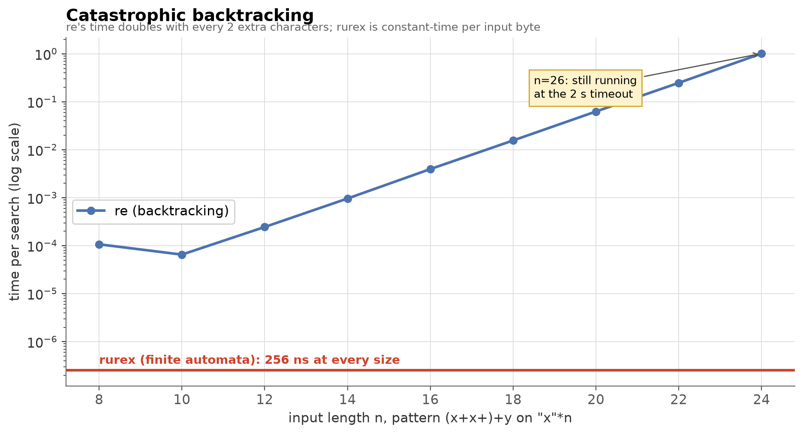
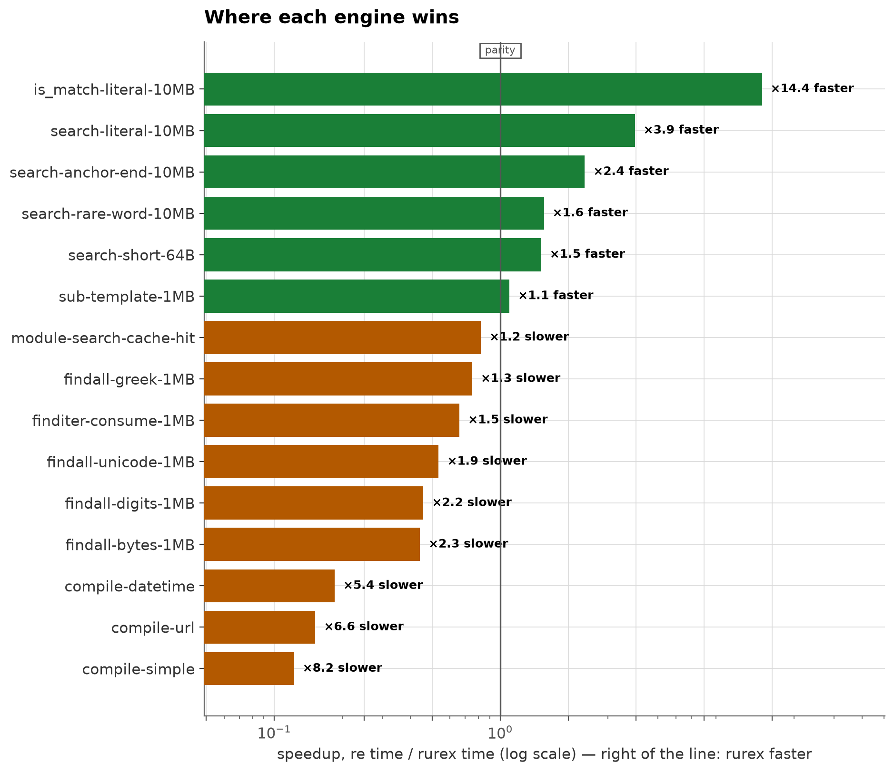
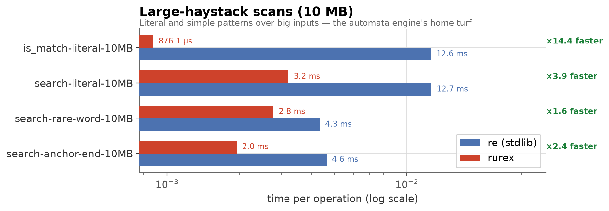
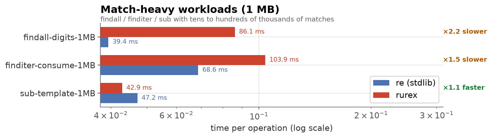
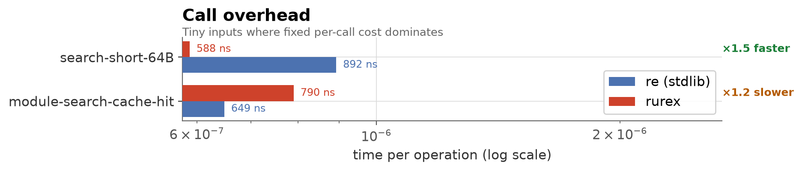
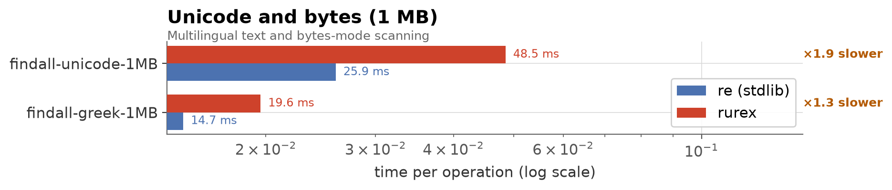
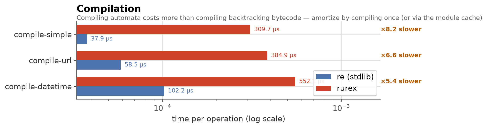

# Benchmarks: `rurex` vs `re`

How the linear-time engine compares to the standard library's
backtracking engine, measured end to end from Python — including every
bit of object construction a real user pays for.

The short version: **rurex wins where scanning dominates** (large
inputs, rare matches — up to **14× faster**), **`re` wins where match
extraction dominates** (hundreds of thousands of small matches — about
**2× faster**) and at **compilation** (about **6–8× faster**). And one
class of input exists where `re` simply cannot finish at all:



That chart is the reason rurex exists. For `(x+x+)+y` over `n`
repeated `x` characters, `re`'s time **doubles with every 2 extra
characters** — 1.0 s at n=24, still running at the 2-second timeout at
n=26 — while rurex answers every input in **~250 ns**, because finite
automata cannot backtrack. This is a safety property (ReDoS
resistance), not a speed feature: any pattern, any input, worst case
*O(m·n)*.

## Where each engine wins



Every measured case, sorted. Green: rurex faster. Orange: `re` faster.

## Methodology

- **End-to-end timing.** Each case times the Python-visible operation
  (method call → returned objects), not the engine in isolation.
  rurex's per-match Python-object construction is therefore included —
  that is the honest number a user experiences.
- **Timing protocol.** `timeit`-style auto-calibrated iteration counts
  (≥ 0.2 s of work per measurement), 5 repeats, **median** reported.
- **Release build.** All rurex numbers use `maturin develop
  --release` (opt-level 3, fat LTO). Debug-profile numbers would be
  meaningless.
- **Deterministic inputs.** All haystacks are generated from fixed
  seeds; literal targets sit at the *end* of scan texts (the worst
  case for both engines).
- **`re` compile cache neutralized.** For the compile cases the
  harness calls `re.purge()` before every `re.compile()`, because
  `re.compile` is backed by an internal cache — otherwise `re` would
  be timed on a cache hit (~300 ns) against rurex's real compilation.
  `rurex.compile` is uncached by design; module-level functions have
  their own bounded cache on both sides (the dispatch case measures
  cache hits on both).

## Environment

| | |
|---|---|
| CPU | Intel Core i5-8350U @ 1.70 GHz |
| OS | Linux 6.12 (Debian 13) |
| Python | CPython 3.13.5 |
| rurex | 0.1.0, release profile (opt-level=3, LTO=fat) |
| opponent | stdlib `re` (same interpreter) |

Numbers are machine-specific; expect different absolute values and
somewhat different ratios elsewhere. Reproduce with the commands
below.

## Results

### Large-haystack scans (10 MB)

Literal and simple patterns over big inputs — the automata engine's
home turf. The literal `is_match` case is nearly pure prefilter
(`memchr`-style scanning in SIMD), which is why it is 14× faster.



| Case | `re` | rurex | Verdict |
|---|---:|---:|---|
| `is_match` literal, match at end | 12.6 ms | 0.88 ms | rurex ×14.4 |
| `search` literal, match at end | 12.7 ms | 3.2 ms | rurex ×3.9 |
| `search` rare word (`zebra\d{4}`) | 4.3 ms | 2.8 ms | rurex ×1.6 |
| `search` anchored (`xyzzy$`) | 4.6 ms | 2.0 ms | rurex ×2.4 |

### Match-heavy workloads (1 MB)

Tens to hundreds of thousands of matches. Here `re`'s fully
C-implemented match-object loop wins: rurex currently builds each
`Match`'s span data through Python-level slicing, which costs more
than the scan saves on match-dense inputs.



| Case | `re` | rurex | Verdict |
|---|---:|---:|---|
| `findall(r"\d{3,4}")`, ~120k matches | 39.4 ms | 86.1 ms | `re` ×2.2 |
| `finditer` fully consumed | 68.6 ms | 103.9 ms | `re` ×1.5 |
| `sub` with group template, ~40k matches | 47.2 ms | 42.9 ms | rurex ×1.1 |

### Call overhead

Tiny inputs where fixed per-call cost dominates. A precompiled
`rurex.Regex.search` call is faster than `re`'s (its bound-method
dispatch is heavier than the PyO3 path); a **module-level** call
(`rurex.search(...)` with its pattern cache) pays one extra dispatch
and is slightly behind `re.search` on a cache hit.



| Case | `re` | rurex | Verdict |
|---|---:|---:|---|
| `search`, 55-byte text (precompiled) | 892 ns | 588 ns | rurex ×1.5 |
| module `search`, cache hit | 649 ns | 790 ns | `re` ×1.2 |

### Unicode and bytes (1 MB)

Multilingual (Greek/Cyrillic/CJK/Latin) text and bytes-mode scanning.
rurex carries byte-offset-to-character conversion on `str`, and both
match-heavy penalties above apply; `re`'s C loop stays ahead.



| Case | `re` | rurex | Verdict |
|---|---:|---:|---|
| `findall(r"\w+")` multilingual | 25.9 ms | 48.5 ms | `re` ×1.9 |
| `findall(r"[α-ω]+")` | 14.7 ms | 19.6 ms | `re` ×1.3 |
| `findall(rb"\d+")` bytes | 38.6 ms | 87.5 ms | `re` ×2.3 |

### Compilation

Compiling finite automata costs more than compiling backtracking
bytecode — roughly 6–8× on these patterns (0.3–0.6 ms vs 0.04–0.1 ms).
This is the price of the linear-time guarantee. In practice it
amortizes: compile once and reuse (the intended usage), or go through
the module-level functions, whose 512-entry pattern cache hides
compilation from hot loops exactly like `re`'s does.



| Case | `re` | rurex | Verdict |
|---|---:|---:|---|
| simple date pattern | 38 µs | 310 µs | `re` ×8.2 |
| URL-ish pattern | 59 µs | 385 µs | `re` ×6.6 |
| ISO datetime, 6 groups | 102 µs | 552 µs | `re` ×5.4 |

## Interpretation

- **Scan-bound work is rurex's territory**: big inputs, few matches,
  untrusted input. The bigger the haystack relative to the number of
  matches, the bigger the win.
- **Match-dense extraction is `re`'s territory** today. Producing a
  hundred thousand small Python match objects costs more in rurex than
  the engine saves; if your workload extracts huge numbers of matches
  from small inputs, stay with `re` (or measure your own case).
- **Compile cost is real but amortized** by design: compile once, or
  use the cached module functions.
- **The safety property is free** where it matters: no input can make
  rurex blow up, and on hostile patterns `re` does not finish at all.

## Reproducing

```sh
python -m venv .venv && source .venv/bin/activate
pip install maturin pytest matplotlib
maturin develop --release          # release build — mandatory

python benchmarks/run.py           # runs the suite, writes results.json
python benchmarks/make_charts.py   # results.json -> docs/img/*.png
```

`benchmarks/cases.py` defines every case (patterns, haystacks, seeds);
`benchmarks/run.py` is the harness (auto-calibration, medians,
environment capture); `benchmarks/make_charts.py` regenerates the
charts from `results.json`. This page's numbers come from the
environment above; regenerate on your own hardware before making
decisions that depend on them.

---

*The harness, raw results (`benchmarks/results.json`), and chart code
are in [`benchmarks/`](../benchmarks/). Numbers on this page were
measured on 2026-10-16 with rurex 0.1.0.*
