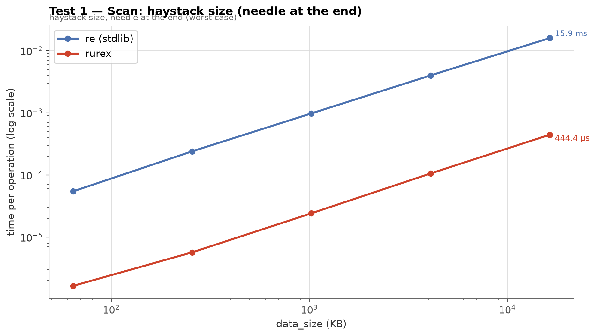
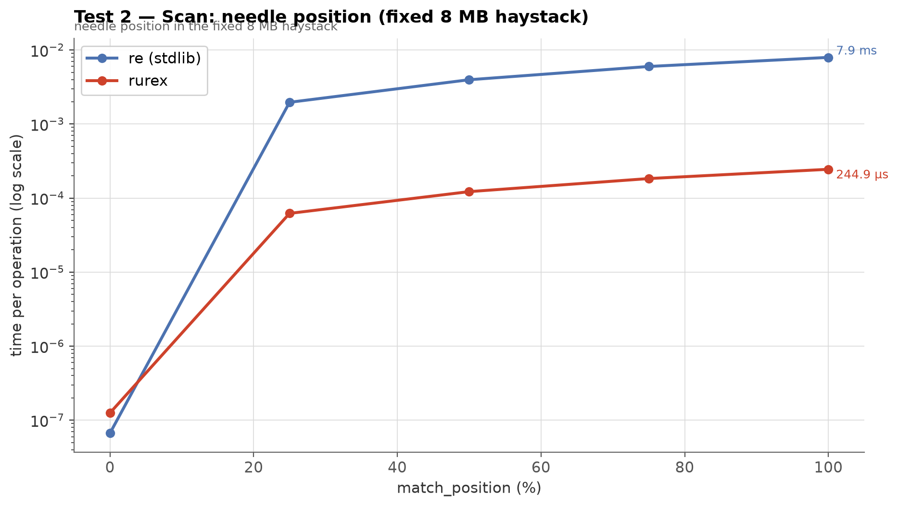
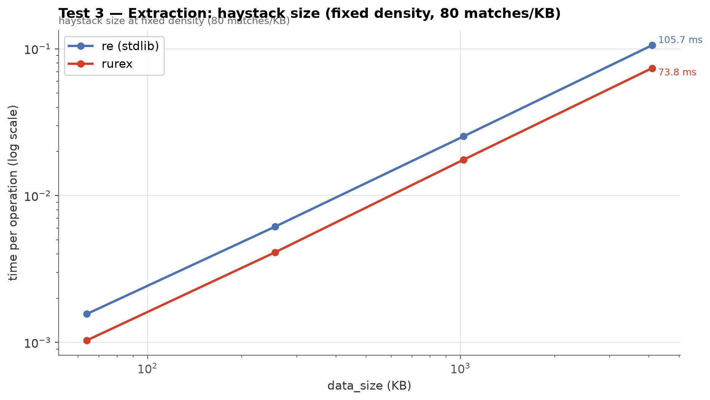
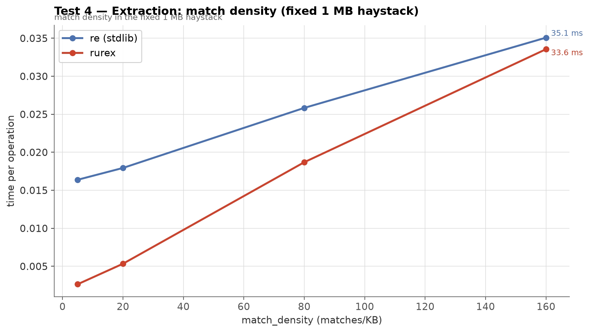
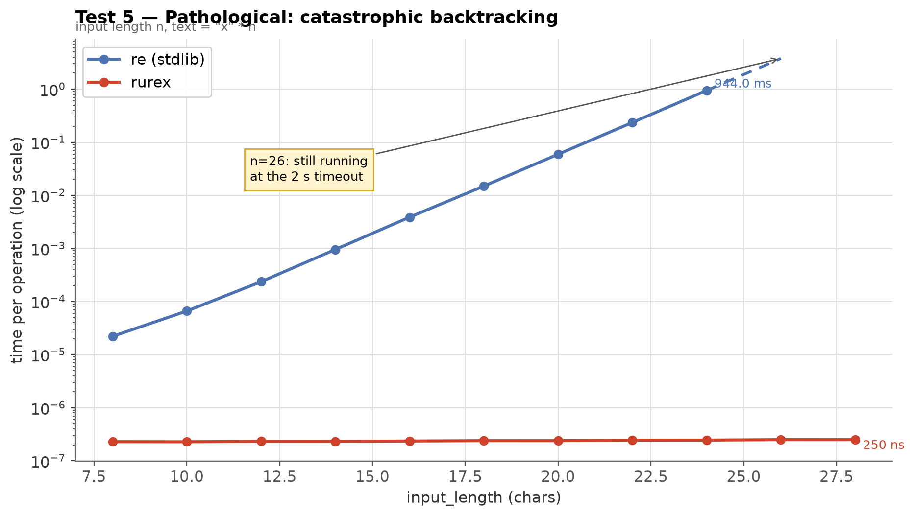
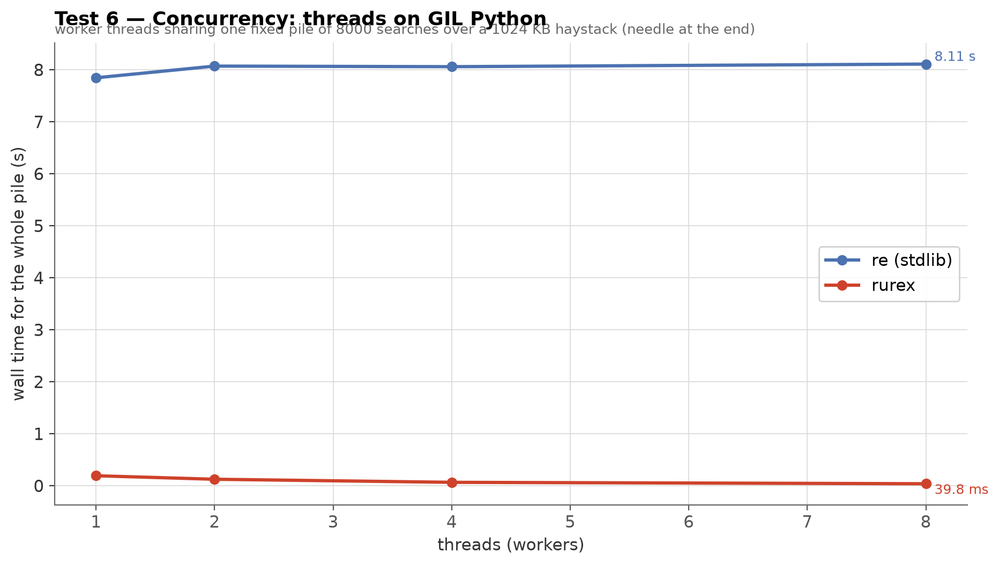
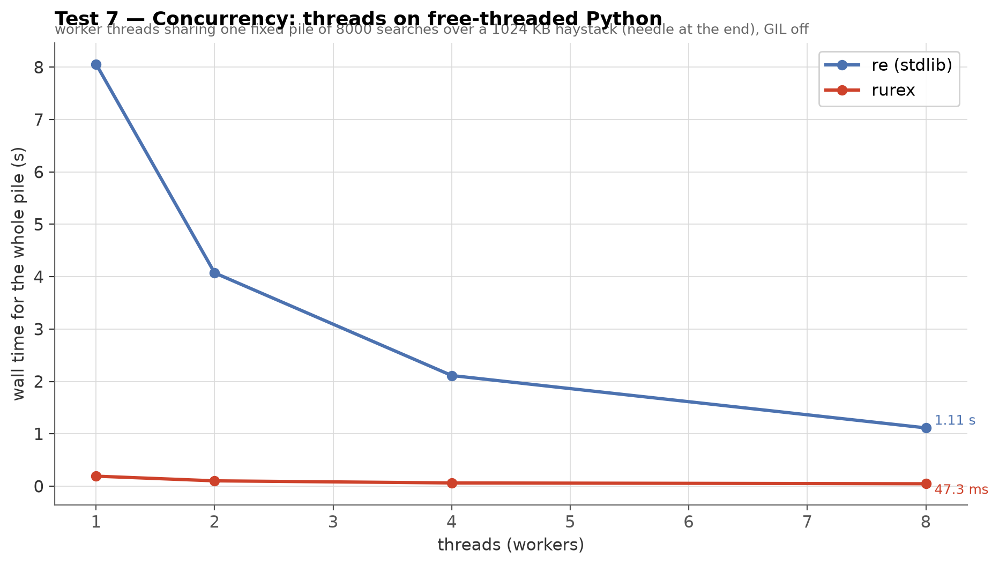
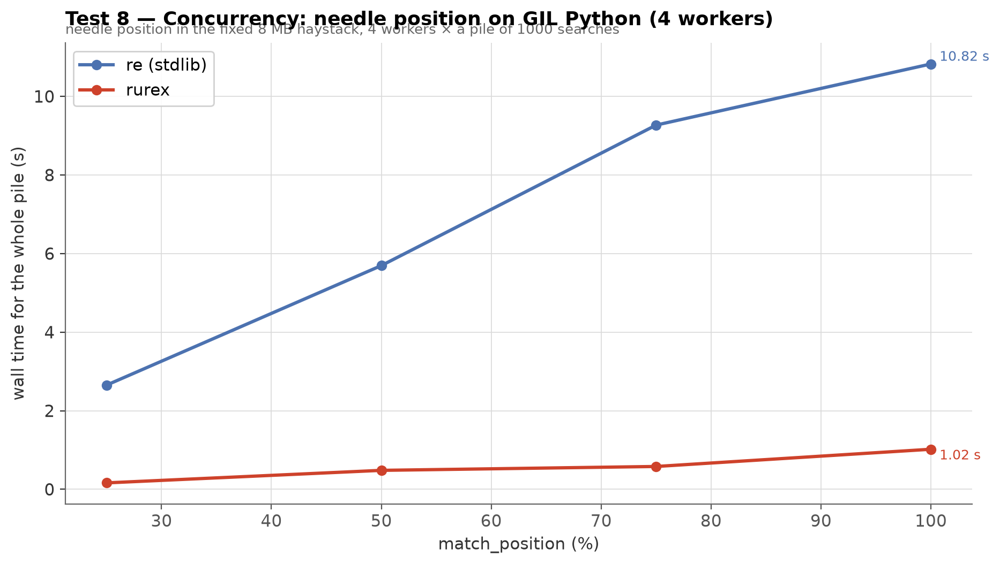
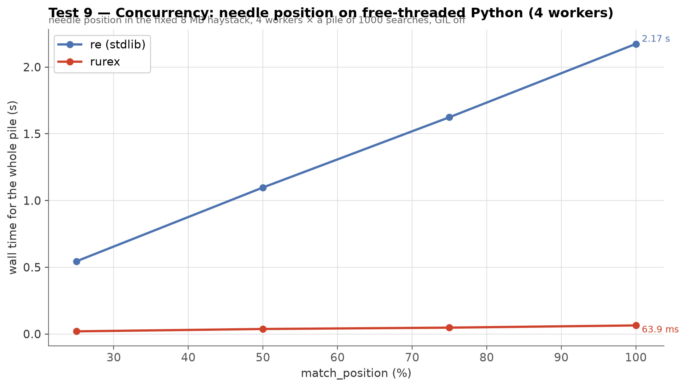

# Benchmarks: `rurex` vs `re`

Nine single-variable benchmark tests comparing the linear-time engine
to the standard library's backtracking engine, measured end to end from
Python — including every bit of object construction a real user pays
for. Every test varies exactly one parameter (stated in its title) and
every chart has two axes: the **variable parameter** on X and **time
per operation** on Y.

- **Test 1 — Scan vs haystack size:** rurex up to **×13.7 faster**,
  and both engines scale linearly.
- **Test 2 — Scan vs needle position:** with the needle in the very
  first bytes both engines answer in well under a microsecond (`re`
  162 ns, rurex 441 ns); from a quarter of the text onward rurex is
  ×8.0–13.3 faster.
- **Test 3 — Extraction vs haystack size:** rurex ahead ~×1.4 at
  match-dense fixed density.
- **Test 4 — Extraction vs match density:** rurex ahead at every
  measured density — ×6.2 when matches are sparse, parity at the densest.
- **Test 5 — Pathological:** `re` never finishes; rurex answers in
  **~250 ns** at any size.
- **Test 6 — Threads on GIL Python:** a fixed pile of 8000 scans
  split across 1–8 workers — `re` starts at 10.0 s and only worsens
  (20.7 s at 8 workers; the GIL serializes it), rurex finishes in
  0.53–1.16 s at every thread count.
- **Test 7 — Threads on free-threaded Python:** the same pile on
  3.14t (GIL off) — both engines scale ~3–4× and rurex keeps an
  11–15× lead at every point.
- **Test 8 — Needle position × 4 threads on GIL Python:** Test 2's
  8 MB haystack as a 1000-search pile across 4 workers — `re` pays
  its serialized per-op cost at every position (×10.7–18.0 slower);
  rurex gains only ~1.2–1.3× from the workers.
- **Test 9 — Needle position × 4 threads on free-threaded Python:**
  the same pile on 3.14t — both engines scale 3.1–3.8× and rurex
  stays ×9.9–13.6 ahead at every position.

A standalone HTML twin of this page (images embedded) can be rendered
locally for browser viewing: `python benchmarks/make_charts.py --html`
writes `docs/benchmarks.html`.

A real-world complement — @mention extraction over 1M Telegram posts
(the extraction-bound regime, one cold run per measured point) lives
in [`telegram-benchmarks.html`](telegram-benchmarks.html).

## Methodology

- **One variable per test.** Each test fixes its context (haystack
  size, density, ...) as stated in the title and sweeps a single
  parameter; charts plot parameter vs time.
- **End-to-end timing.** The Python-visible operation is timed
  (method call → returned objects), not the engine in isolation.
  rurex's per-match Python-object construction is included — that is
  the honest number a user experiences.
- **Timing protocol.** `timeit`-style auto-calibrated iteration counts
  (≥ 0.2 s of work per measurement), median of 3 repeats. The
  pathological test is single-shot under a 2 s timeout guard on `re`,
  because its runtime explodes.
- **Release build.** All rurex numbers use `maturin develop
  --release` (opt-level 3, fat LTO).
- **Deterministic inputs.** Haystacks are generated from fixed seeds;
  needle positions and densities are stated per test.
- **Threading protocol (Tests 6–9).** A fixed pile of searches is
  split evenly across barrier-started worker threads; the chart
  plots wall-clock time for the whole pile, so a dropping line means
  threads turned into throughput. One measurement per point (each is
  an aggregate of thousands of ops); Tests 7 and 9 run in a
  free-threaded 3.14t subprocess orchestrated by the harness. Tests
  6–7 sweep the worker count (pile of 8000 over a 1 MB haystack);
  Tests 8–9 fix 4 workers and sweep the needle's position (pile of
  1000 over Test 2's 8 MB haystack). Position 0% is excluded from the
  threaded sweeps: a ~160 ns `re` op gives the whole pile ~0.2 ms of
  work — thread startup alone costs milliseconds, so that point
  would time the harness, not the engines. The 1 MB haystack is
  cache-resident on this CPU, which flatters absolute scan throughput
  equally for both engines; the 8 MB haystack exceeds the CPU's
  6 MB L3, so four parallel scanners share memory bandwidth (one
  reason Tests 8–9 scale below the ideal 4×).

## Environment

| | |
|---|---|
| CPU | Intel Core i5-8350U @ 1.70 GHz (4 cores / 8 threads) |
| OS | Linux 6.12 (Debian 13) |
| Python | CPython 3.13.5 |
| rurex | 0.1.0, release profile (opt-level=3, LTO=fat) |
| opponent | stdlib `re` (same interpreter; Tests 6–7 also on
  free-threaded CPython 3.14.8) |

Numbers are machine-specific; expect different absolute values and
somewhat different ratios elsewhere.

---

## Test 1 — Scan: haystack size (needle at the end)

A plain literal search for a single needle occurring once, with the
needle at the very end of the text — the worst case, the whole
haystack must be scanned. Variable: haystack size from 64 KB to
16 MB. This is the classic log-grep workload: rurex scans with
SIMD-accelerated prefilters, `re` steps its backtracking VM character
by character.

**Pattern**

```python
"the-needle-string"
```

**Method:** `.search(text)` — first match anywhere; timed per call.

**Data example** (word filler, one needle at the end)

```
jumps delta data node item brown lorem fox alpha item world alpha text
amet node lazy fox alpha the the-needle-string …
```



| Size | `re` | rurex | Speedup |
|---:|---:|---:|---:|
| 64 KB | 76.6 µs | 5.8 µs | rurex ×13.1 |
| 256 KB | 311 µs | 22.7 µs | rurex ×13.7 |
| 1 MB | 1.25 ms | 92.2 µs | rurex ×13.5 |
| 4 MB | 4.99 ms | 395 µs | rurex ×12.7 |
| 16 MB | 20.2 ms | 3.19 ms | rurex ×6.3 |

Both engines scale linearly; rurex' constant is several times smaller.
The advantage narrows at 16 MB as scanning becomes memory-bound — the
prefilter's CPU advantage stops mattering when both engines wait on
RAM.

---

## Test 2 — Scan: needle position (fixed 8 MB haystack)

The same single-needle literal search as Test 1, but the haystack is
fixed at 8 MB and the variable is where in the text the needle sits,
from the first bytes (0%) to the very end (100%). Position 0% favors
`re`'s instant fast path; every later position is scan-bound.

**Pattern**

```python
"the-needle-string"
```

**Method:** `.search(text)` — first match anywhere; timed per call.

**Data example** (needle mid-text, as at position ~50%)

```
… dog lorem beta jumps the-needle-string gamma alpha data sit lorem …
```



| Needle at | `re` | rurex | Speedup |
|---:|---:|---:|---:|
| 0% | 162 ns | 441 ns | `re` ×2.7 |
| 25% | 2.50 ms | 188 µs | rurex ×13.3 |
| 50% | 5.04 ms | 447 µs | rurex ×11.3 |
| 75% | 7.60 ms | 811 µs | rurex ×9.4 |
| 100% | 10.1 ms | 1.26 ms | rurex ×8.0 |

The closest point of the race is a needle in the very first bytes:
`re`'s fast path answers in 162 ns and rurex in 441 ns — both well
under a microsecond, both invisible to any real workload. Past the
first quarter of the text, rurex' scan speed dominates by ×8.0–13.3.
(An earlier build showed a ~0.7 ms floor here — every `search` call
was counting the characters of the whole haystack to fill
`Match.endpos` even when the match sat in the first bytes; `endpos` is
now computed lazily, on first read.)

---

## Test 3 — Extraction: haystack size (fixed density, 80 matches/KB)

Digit-run extraction (`findall`) over word filler at a fixed density
of 80 matches per KB. Variable: haystack size from 64 KB to 4 MB (the
match count grows with it). This is the match-dense regime, where
building the returned values — not scanning — dominates.

**Pattern**

```python
r"\d{3,4}"
```

**Method:** `.findall(text)` — one call returns every match, as a list of strings.

**Data example** (digits in word filler at 80/KB)

```
7685 value word word beta beta lorem node alpha word value text value
alpha word value value node al …
```



| Size | `re` | rurex | Speedup |
|---:|---:|---:|---:|
| 64 KB | 1.48 ms | 1.02 ms | rurex ×1.46 |
| 256 KB | 5.88 ms | 4.04 ms | rurex ×1.46 |
| 1 MB | 24.7 ms | 17.3 ms | rurex ×1.43 |
| 4 MB | 100.4 ms | 74.2 ms | rurex ×1.35 |

At this density rurex is steadily ~×1.4 ahead: `findall` builds only
the returned values (strings, or one string per group) in one pass —
no intermediate match objects.

---

## Test 4 — Extraction: match density (fixed 1 MB haystack)

The same digit-run extraction as Test 3, but the haystack is fixed at
1 MB and the variable is match density, from 5 to 160 matches per KB.
This isolates the per-match cost from the scan cost: sparse
matches are scan-bound, dense matches are extraction-bound.

**Pattern**

```python
r"\d{3,4}"
```

**Method:** `.findall(text)` — one call returns every match, as a list of strings.

**Data example** (digits in word filler at 160/KB)

```
7685 4432 9766 word alpha 6210 5510 text lorem 5965 8533 word value …
```



| Density | `re` | rurex | Speedup |
|---:|---:|---:|---:|
| 5 /KB | 16.5 ms | 2.66 ms | rurex ×6.2 |
| 20 /KB | 18.1 ms | 5.43 ms | rurex ×3.3 |
| 80 /KB | 24.6 ms | 17.7 ms | rurex ×1.4 |
| 160 /KB | 32.9 ms | 32.6 ms | `re` ×1.0 |

With sparse matches, scanning dominates and rurex is up to 6.2×
faster; as matches multiply, the per-match cost of building the
returned values takes over and `re` closes to parity — the two
densest regimes sit within run-to-run noise of each other on this
machine.

---

## Test 5 — Pathological: catastrophic backtracking

The pattern `(x+x+)+y` never matches a run of x's — and for a
backtracking engine, the number of ways to distribute the x's across
the nested groups grows exponentially: `re`'s time doubles with every
two extra input characters. A finite-automata engine cannot backtrack,
so rurex' time is flat. This is a **safety property** (ReDoS
resistance), not a speed feature: no pattern and no input can make
rurex blow up.

**Pattern**

```python
r"(x+x+)+y"
```

**Method:** `.search(text)` — one single call per point, no timed loop
(`re` wrapped in a 2 s timeout guard).

**Data example**

```
xxxxxxxxxxxxxxxxxxxxxxxx    (n = 24 of the sweep; no y — nothing matches)
```



| n | `re` | rurex |
|---:|---:|---:|
| 8 | 22.2 µs | 230 ns |
| 12 | 236 µs | 233 ns |
| 16 | 3.89 ms | 237 ns |
| 20 | 59.4 ms | 240 ns |
| 24 | 944 ms | 246 ns |
| 26 | *≥ 2 s — still running at the timeout* | 251 ns |
| 28 | — | 250 ns |

Extrapolating `re`'s doubling curve, n=40 would take longer than the
age of the universe. rurex answers every input in well under half of a
microsecond, and would keep doing so at n=40, n=400, n=4 million.

---

## Test 6 — Concurrency: threads on GIL Python

The scan workload of Test 1 as one fixed pile — 8000 whole-haystack
searches over a 1 MB haystack, needle at the end — split evenly
across N barrier-started worker threads. Y is wall-clock time for
the whole pile: a dropping line means threads became throughput.

**Pattern**

```python
"the-needle-string"
```

**Method:** `.search(text)` — 8000 calls split across N threads;
Y is the wall-clock for the whole pile.



| Workers | `re` | rurex | Speedup |
|---:|---:|---:|---:|
| 1 | 10.0 s | 0.75 s | rurex ×13.3 |
| 2 | 10.3 s | 0.53 s | rurex ×19.6 |
| 4 | 13.1 s | 0.94 s | rurex ×14.0 |
| 8 | 20.7 s | 1.16 s | rurex ×17.9 |

On GIL Python nobody buys throughput from threads. `re` never beats
its one-worker time (10.0 s) and deteriorates to 20.7 s at eight
workers: the GIL serializes every search, and contention adds
overhead on top. rurex releases the GIL around its scans and finishes
the pile 13–20× faster, but its own line flattens too: release
rurex's scan is so fast (~100 µs/op) that the GIL-held part of each
call — building the `Match`, converting spans — dominates, and that
part cannot parallelize. Threads turn into throughput only without
the GIL (Test 7).

---

## Test 7 — Concurrency: threads on free-threaded Python

The same pile as Test 6 — 8000 searches, split across N workers,
wall-clock for the pile — on free-threaded CPython 3.14t with the
GIL off.

**Pattern**

```python
"the-needle-string"
```

**Method:** `.search(text)` — 8000 calls split across N threads;
Y is the wall-clock for the whole pile.



| Workers | `re` | rurex | Speedup |
|---:|---:|---:|---:|
| 1 | 11.3 s | 0.78 s | rurex ×14.6 |
| 2 | 5.82 s | 0.42 s | rurex ×13.9 |
| 4 | 3.09 s | 0.26 s | rurex ×11.9 |
| 8 | 2.56 s | 0.24 s | rurex ×10.8 |

Without the GIL both engines scale: `re` chews the pile 4.4× faster
at 8 workers than at 1, rurex 3.3× (both saturating this
4-core/8-thread machine). And rurex keeps its single-thread lead at
every point — 0.24 s vs 2.56 s at 8 workers. The single-threaded
`re` time also shows the free-threaded interpreter's cost honestly:
11.3 s here vs 10.0 s on GIL Python; rurex is within noise (0.78 vs
0.75 s).

---

## Test 8 — Concurrency: needle position on GIL Python (4 workers)

Test 2's scan workload as one fixed pile — 1000 whole-haystack
searches over the 8 MB haystack, split evenly across 4 barrier-
started workers — with the needle's position as the variable
(25–100%). Position 0% is excluded: a ~160 ns `re` op gives the whole
pile ~0.2 ms of work, less than thread startup itself, so that point
would time the harness, not the engines.

**Pattern**

```python
"the-needle-string"
```

**Method:** `.search(text)` — 1000 calls split across 4 fixed threads;
Y is the wall-clock for the whole pile.



| Needle at | `re` | rurex | Speedup |
|---:|---:|---:|---:|
| 25% | 2.90 s | 161 ms | rurex ×18.0 |
| 50% | 5.55 s | 342 ms | rurex ×16.2 |
| 75% | 9.12 s | 614 ms | rurex ×14.9 |
| 100% | 10.7 s | 998 ms | rurex ×10.7 |

`re`'s wall equals its serialized per-op cost — Test 2's column ×
1000 plus 5–20% contention: the GIL serializes every search, so four
workers buy nothing and the pile grows linearly with the needle's
position. rurex stays 10.7–18× ahead at every position, but its own
overlap is modest, 1.2–1.3× over its serialized work (188 ms →
161 ms at 25%): after every GIL-released scan the call must
re-acquire the GIL to build the `Match`, and that serialized Python
side — plus four scanners sharing memory bandwidth on an 8 MB doc,
above this CPU's 6 MB L3 — caps the gain. The lead narrows toward
100% for the same reason as in Test 2: rurex' per-op advantage itself
shrinks the more of the haystack must be scanned.

---

## Test 9 — Concurrency: needle position on free-threaded Python (4 workers)

The same pile as Test 8 — 1000 searches over the 8 MB haystack, 4
workers, needle position 25–100% — on free-threaded CPython 3.14t
with the GIL off.

**Pattern**

```python
"the-needle-string"
```

**Method:** `.search(text)` — 1000 calls split across 4 fixed threads;
Y is the wall-clock for the whole pile.



| Needle at | `re` | rurex | Speedup |
|---:|---:|---:|---:|
| 25% | 793 ms | 58.2 ms | rurex ×13.6 |
| 50% | 1.60 s | 135 ms | rurex ×11.8 |
| 75% | 2.41 s | 221 ms | rurex ×10.9 |
| 100% | 3.26 s | 329 ms | rurex ×9.9 |

Without the GIL both engines turn the four workers into throughput at
every position, and almost uniformly: `re` finishes its pile 3.1×
faster than its serialized cost at every position (2.50 s → 0.79 s at
25%, 10.1 s → 3.26 s at 100%), rurex 3.2–3.8×. Both fall short of the
ideal 4× in part because the 8 MB haystack exceeds this CPU's 6 MB
L3, so four parallel scanners share memory bandwidth — Test 7's
cache-resident 1 MB piles let `re` scale 3.7× at four workers (4.4×
at eight). rurex keeps a 9.9–13.6× lead at every position.

---

## Reproducing

```sh
make venv && source .venv/bin/activate   # or: python -m venv .venv + pip install
maturin develop --release          # release build — mandatory

# Test 7 needs a free-threaded interpreter with a release rurex:
uv venv --python 3.14t .venv-t
VIRTUAL_ENV=.venv-t uv pip install maturin pytest
.venv-t/bin/maturin develop --release

python benchmarks/run.py           # runs all 7 tests (spawns .venv-t for Test 7)
python benchmarks/make_charts.py --html   # charts + docs/benchmarks.html
```

`benchmarks/suite.py` defines the nine tests (patterns, data
generators, the single variable and fixed context per test);
`benchmarks/run.py` is the harness (auto-calibration, medians,
timeout guard, environment capture); `benchmarks/make_charts.py`
regenerates the charts and the HTML render from `results.json`. This
page's numbers come from the environment above; regenerate on your own
hardware before making decisions that depend on them.

---

*Raw results: [`benchmarks/results.json`](../benchmarks/results.json).
Numbers on this page were measured on 2026-10-17 with rurex 0.1.0.*
