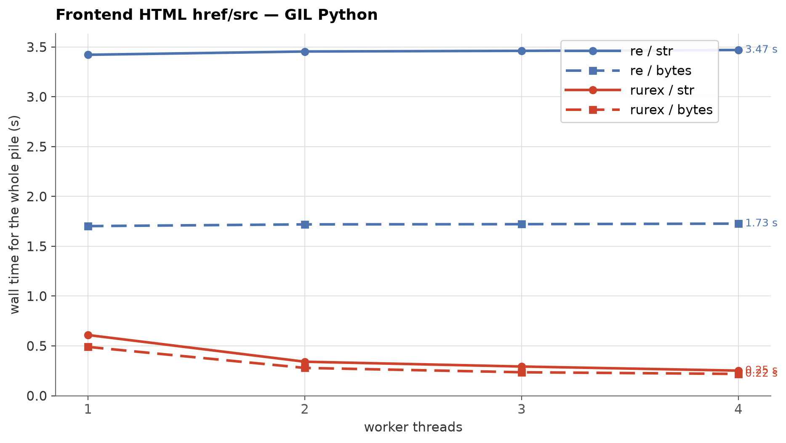
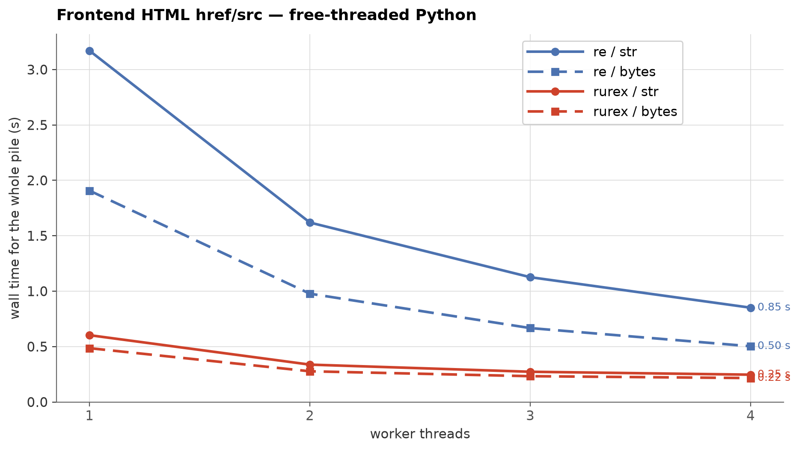

# Frontend HTML href/src extraction: rurex vs `re`

Real-world task: **one** pass of `.findall(document)` over real frontend
HTML pages. Each measured point is a fresh interpreter process that
loads the corpus, pins its workers to distinct physical cores, runs a
fixed CPU warm-up on a separate buffer, and then performs the single
pass split across N barrier-started workers; there is no repeat scan.

This is the long-haystack complement to the
[Telegram benchmark](telegram-benchmark.md): documents are large
(median 117 KB), matches are dense
(191 per document, up to 4,692),
and capture groups are part of the result.

## Methodology

- **Pattern** (quoted and unquoted HTML attribute values):
  `(?i)\b(?:href|src)\s*=\s*(?:"([^"]*)"|'([^']*)'|([^\s>]+))`
- **Corpus**: the owner-provided frontend HTML sample, 2,086 documents
  and 479.9 MiB decoded. The benchmark downloads
  `frontend-html-500mb-v1.tgz` from the
  [`bench-data-html-v1` release](https://github.com/lorien/rurex/releases/tag/bench-data-html-v1),
  sha256-verifies it, and caches a length-prefixed local copy. See
  [`benchmarks/html/PROVENANCE.md`](../benchmarks/html/PROVENANCE.md).
  The default run uses the first 269 MiB of the corpus
  (1,127 documents); `--full` loads all of it.
- **CPU placement and warm-up**: the process is pinned to distinct
  physical cores; free-threaded workers are pinned one per core, while
  GIL workers share the process affinity so the active thread does not
  bounce across cores. All workers run a fixed CPU-bound warm-up on a
  separate buffer before the timed barrier. The measured corpus is
  never touched by the warm-up. Governor, load average and per-CPU
  frequency are recorded in the raw results.
- **Core lease**: the whole matrix holds `/tmp/core4.lock` (mode
  0666). A second run prints the owner metadata, waits up to 600 s, and
  then fails instead of running on the same cores.
- **Timing window**: from the instant the post-warm-up barrier releases
  to the instant the slice is finished; a point is the max across
  workers. Load and pattern compile are outside the window, identically
  for both engines. Every run's match count must equal
  335,801.
- **Repeats**: published rows are the median of three complete runs;
  each raw result records the individual wall times.
- **Interpreters**: GIL CPython 3.13 and free-threaded 3.14t, one fresh
  subprocess per point. CPU: 13th Gen Intel(R) Core(TM) i5-13500.

## GIL Python



| Workers | `re` str | `re` bytes | rurex str | rurex bytes | rurex/re str | rurex/re bytes |
|---:|---:|---:|---:|---:|---:|---:|
| 1 | 3.42 s | 1.70 s | 0.61 s | 0.49 s | ×0.18 | ×0.29 |
| 2 | 3.45 s | 1.72 s | 0.35 s | 0.28 s | ×0.10 | ×0.16 |
| 3 | 3.46 s | 1.73 s | 0.28 s | 0.24 s | ×0.08 | ×0.14 |
| 4 | 3.46 s | 1.72 s | 0.26 s | 0.22 s | ×0.07 | ×0.13 |

*(ratio < 1 = rurex faster)*

Single-threaded, rurex answers the parsed-`str` form in
0.61 s against `re`'s
3.42 s (×0.18), and the
bytes form in 0.49 s against
1.70 s (×0.29).

The `str` result is the opposite of the short-post Telegram regime.
Documents here have a median of 117 KB, so the cold
UCS-to-UTF-8 transcode is amortized over far more text; the
required-first-byte prefilter still skips pages that cannot contain
`href` or `src`, and the AVX2 kernel handles the rest. The engine and
its SIMD prefilters then do the dominant work.

Threads reinforce the difference. These documents are above the 4 KB
GIL-release threshold, so rurex releases the GIL during the scan, and
source buffers of at least 32 KB also release it around the cold
transcode itself, so one worker's encode does not block the others:
`str` drops from 0.61 to
0.26 s and bytes from
0.49 to
0.22 s at four workers. `re` stays flat
on `str` (3.42 to
3.46 s) because it never releases the GIL
during matching.

## Free-threaded Python



| Workers | `re` str | `re` bytes | rurex str | rurex bytes | rurex/re str | rurex/re bytes |
|---:|---:|---:|---:|---:|---:|---:|
| 1 | 3.18 s | 1.91 s | 0.60 s | 0.48 s | ×0.19 | ×0.25 |
| 2 | 1.62 s | 0.97 s | 0.34 s | 0.28 s | ×0.21 | ×0.29 |
| 3 | 1.12 s | 0.67 s | 0.28 s | 0.23 s | ×0.25 | ×0.35 |
| 4 | 0.85 s | 0.51 s | 0.25 s | 0.21 s | ×0.29 | ×0.42 |

*(ratio < 1 = rurex faster)*

Without the GIL both engines scale. rurex goes from
0.60 to
0.25 s on `str` and from
0.48 to
0.21 s on bytes; `re` goes from
3.18 to 0.85 s
on `str` and from 1.91 to
0.51 s on bytes. rurex keeps the lead at
every thread count. The `str` and bytes rows are close for rurex
because the transcode is a small part of a long-document pass.

## Reading the numbers

This page and the [Telegram page](telegram-benchmark.md) describe the
two ends of the real-world spectrum. Telegram is short non-ASCII posts
scanned once, where per-call transcode and per-match result building
dominate; rurex had to close that gap with a prefilter and a leaner
`findall`. Frontend HTML is long UTF-8 documents with dense, grouped
extraction, where the engine and its prefilters dominate; rurex leads
on both input forms and scales under the GIL once the documents cross
the release threshold.

Machine-specific; expect different absolute numbers elsewhere.

## Reproducing

```sh
python benchmarks/frontend_html.py && cp benchmarks/frontend_html_results.json run1.json
python benchmarks/frontend_html.py && cp benchmarks/frontend_html_results.json run2.json
python benchmarks/frontend_html.py && cp benchmarks/frontend_html_results.json run3.json
python benchmarks/merge_runs.py run1.json run2.json run3.json -o benchmarks/frontend_html_results.json
python benchmarks/frontend_html_charts.py     # charts, this page, and the HTML twin
```

---

*Raw results: [`benchmarks/frontend_html_results.json`](../benchmarks/frontend_html_results.json).
Numbers on this page were measured on 2026-10-18 with rurex 0.1.0;
see the raw results file for the exact environment.*
