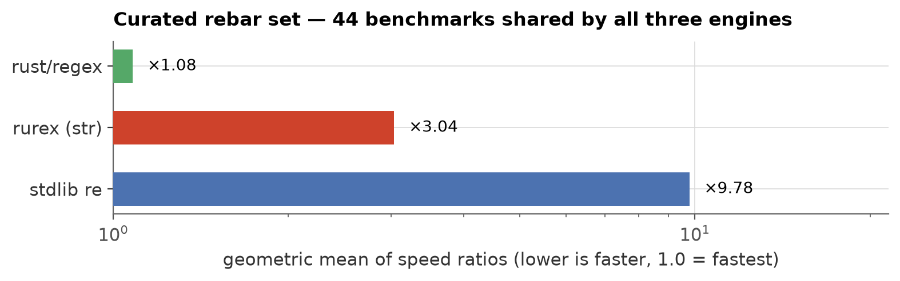
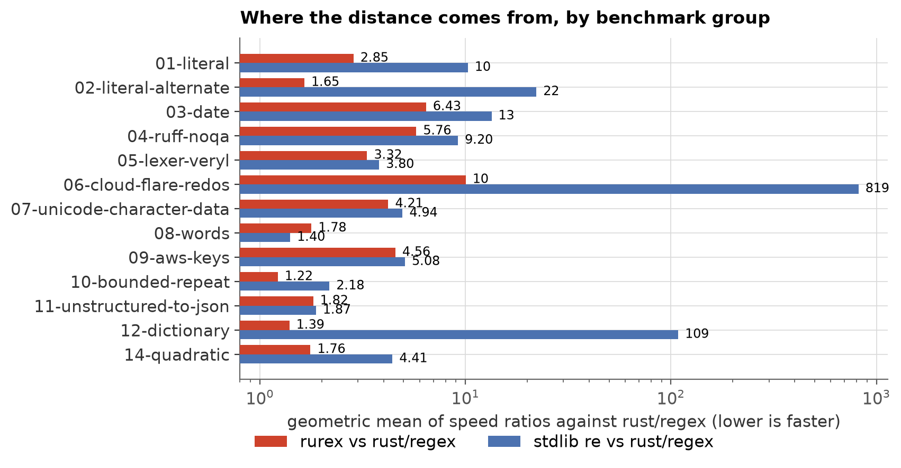
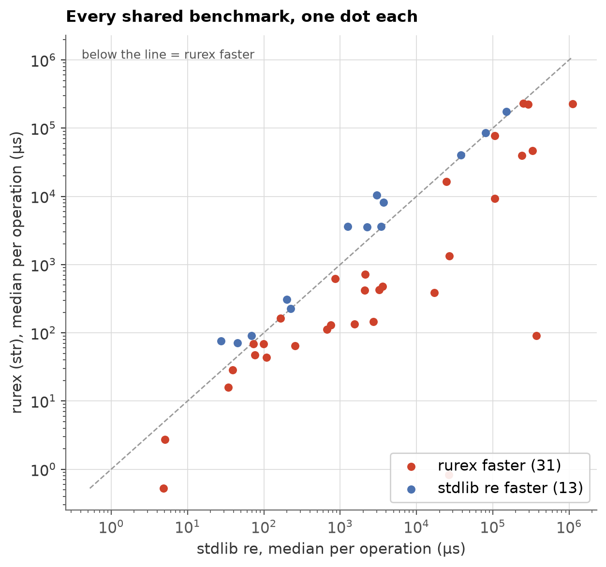
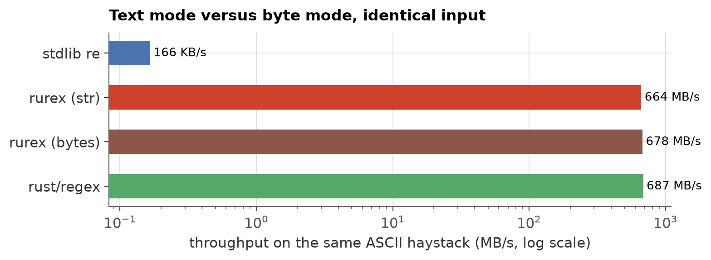

# rebar: rurex against stdlib `re` and the Rust engine

[rebar](https://github.com/BurntSushi/rebar) is BurntSushi's barometer for
comparing regex engines on a curated set of tasks. This page reports how
rurex fares on it against the two engines a Python user actually weighs
it with: the standard library's `re`, which it replaces, and `rust/regex`,
which it embeds.

The metric is rebar's own: each benchmark divides an engine's median time
by the fastest median among the engines that ran it, and an engine's score
is the geometric mean of those ratios across the benchmarks all three
share. **Lower is faster; 1.0 is the fastest engine on that set.** A score
of ×3 means "typically three times the best engine's time".

## Method

| | |
|---|---|
| Date | 2026-10-19 |
| Host | `regexus`, 13th Gen Intel(R) Core(TM) i5-13500 |
| Isolation | `/tmp/core4.lock` lease (cpus [0, 2, 4, 6]), pinned to CPU 0, governor `performance` |
| rebar | 0.1.0 (curated set, `--max-time 3s --max-iters 10`) |
| rurex | 0.2.0, release wheel from PyPI |
| Opponents | stdlib `re`, `rust/regex` (the engine rurex embeds) |
| Checks | every point verified with `rebar measure --test` before timing; no failed points in the data |

| Raw results | sha256 |
|---|---|
| `curated.csv` | 4a700644b280745b… |
| `dict.csv` | 02a26650649db599… |

## The ranking



| engine | score | benchmarks |
|---|---:|---:|
| `rust/regex` | ×1.08 | 44 |
| `python/rurex` | ×3.04 | 44 |
| `python/re` | ×9.78 | 44 |

rurex sits between the engine it embeds and the module it replaces: about
**3.2× faster than `re`** on average, and
about **3.0× off the Rust engine**. The distance to the engine is
not the scanner: the two run the same automata. It is the Python
boundary — argument handling and one Python object per match — plus, on
non-ASCII text, the cost of materialising UTF-8.

## Where the distance comes from



| group | rurex | `re` |
|---|---:|---:|
| `01-literal` | ×2.85 | ×10.28 |
| `02-literal-alternate` | ×1.65 | ×22.15 |
| `03-date` | ×6.43 | ×13.39 |
| `04-ruff-noqa` | ×5.76 | ×9.20 |
| `05-lexer-veryl` | ×3.32 | ×3.80 |
| `06-cloud-flare-redos` | ×10.03 | ×818.57 |
| `07-unicode-character-data` | ×4.21 | ×4.94 |
| `08-words` | ×1.78 | ×1.40 |
| `09-aws-keys` | ×4.56 | ×5.08 |
| `10-bounded-repeat` | ×1.22 | ×2.18 |
| `11-unstructured-to-json` | ×1.82 | ×1.87 |
| `12-dictionary` | ×1.39 | ×108.53 |
| `14-quadratic` | ×1.76 | ×4.41 |

`re` wins 13 of the 44 shared benchmarks, and they fall into
three groups:

- **Compile time** (5 points): rurex parses the pattern with
  `regex-syntax` for `re`-compatible error positions and then builds the
  automata, so `03-date/compile-unicode` costs
  8.15 ms against `re`'s
  3.71 ms.
- **Unicode word matching** (3 points): `\w`/`\b` over a
  non-ASCII `str` pay both the transcode and a Unicode word automaton,
  while `re` matches the UCS buffer directly. `08-words/all-russian` is
  10.37 ms for rurex against
  3.03 ms for `re`.
- **Near parity scans** (5 points): within 15% of each other, with
  `re` marginally ahead.

rurex wins the other 31 points, sometimes by four orders of
magnitude: `re` is a backtracker, and rebar's dictionary and ReDoS
benchmarks make that visible.

| benchmark where `re` wins | rurex | `re` | `re` is |
|---|---:|---:|---:|
| `01-literal/sherlock-ru` | 225.82 µs | 225.23 µs | 1.00× faster |
| `03-date/compile-ascii` | 3.62 ms | 3.46 ms | 1.05× faster |
| `03-date/compile-unicode` | 8.15 ms | 3.71 ms | 2.20× faster |
| `04-ruff-noqa/compile-real` | 91.13 µs | 69.16 µs | 1.32× faster |
| `05-lexer-veryl/single` | 85.15 ms | 80.47 ms | 1.06× faster |
| `07-unicode-character-data/parse-line` | 40.17 ms | 38.22 ms | 1.05× faster |
| `08-words/all-english` | 3.56 ms | 2.25 ms | 1.58× faster |
| `08-words/all-russian` | 10.37 ms | 3.03 ms | 3.42× faster |
| `08-words/long-russian` | 3.60 ms | 1.26 ms | 2.86× faster |
| `09-aws-keys/quick` | 175.81 ms | 150.98 ms | 1.16× faster |
| `10-bounded-repeat/compile-capitals` | 75.50 µs | 27.29 µs | 2.77× faster |
| `10-bounded-repeat/compile-context` | 70.93 µs | 44.84 µs | 1.58× faster |
| `11-unstructured-to-json/extract` | 305.84 µs | 200.40 µs | 1.53× faster |


## Every shared benchmark



| group | benchmark | rurex (str) | `re` | rust/regex | fastest |
|---|---|---:|---:|---:|---|
| `01-literal` | `sherlock-casei-en`| 145.71 µs| 2.74 ms| 86.00 µs| rust/regex |
| `01-literal` | `sherlock-casei-ru`| 423.75 µs| 3.25 ms| 189.55 µs| rust/regex |
| `01-literal` | `sherlock-en`| 64.55 µs| 255.65 µs| 25.41 µs| rust/regex |
| `01-literal` | `sherlock-ru`| 225.82 µs| 225.23 µs| 41.89 µs| rust/regex |
| `01-literal` | `sherlock-zh`| 68.40 µs| 73.02 µs| 18.81 µs| rust/regex |
| `02-literal-alternate` | `sherlock-casei-en`| 390.06 µs| 17.09 ms| 310.56 µs| rust/regex |
| `02-literal-alternate` | `sherlock-casei-ru`| 1.34 ms| 26.86 ms| 1.03 ms| rust/regex |
| `02-literal-alternate` | `sherlock-en`| 133.49 µs| 1.54 ms| 76.02 µs| rust/regex |
| `02-literal-alternate` | `sherlock-ru`| 479.46 µs| 3.61 ms| 245.88 µs| rust/regex |
| `02-literal-alternate` | `sherlock-zh`| 129.86 µs| 752.67 µs| 60.28 µs| rust/regex |
| `03-date` | `ascii`| 39.38 ms| 240.14 ms| 1.95 ms| rust/regex |
| `03-date` | `compile-ascii`| 3.62 ms| 3.46 ms| 1.47 ms| rust/regex |
| `03-date` | `compile-unicode`| 8.15 ms| 3.71 ms| 5.70 ms| stdlib re |
| `03-date` | `unicode`| 46.92 ms| 332.71 ms| 1.95 ms| rust/regex |
| `04-ruff-noqa` | `compile-real`| 91.13 µs| 69.16 µs| 63.23 µs| rust/regex |
| `04-ruff-noqa` | `real`| 226.90 ms| 1.11 s| 19.59 ms| rust/regex |
| `04-ruff-noqa` | `tweaked`| 230.36 ms| 252.14 ms| 20.09 ms| rust/regex |
| `05-lexer-veryl` | `compile-single`| 620.13 µs| 859.01 µs| 276.59 µs| rust/regex |
| `05-lexer-veryl` | `multi`| —| —| 2.16 ms| rust/regex |
| `05-lexer-veryl` | `single`| 85.15 ms| 80.47 ms| 17.30 ms| rust/regex |
| `06-cloud-flare-redos` | `original`| 2.72 µs| 5.08 µs| 191 ns| rust/regex |
| `06-cloud-flare-redos` | `simplified-long`| 836 ns| 26.42 ms| 119 ns| rust/regex |
| `06-cloud-flare-redos` | `simplified-short`| 525 ns| 4.83 µs| 52 ns| rust/regex |
| `07-unicode-character-data` | `compile`| 68.37 µs| 98.94 µs| 28.94 µs| rust/regex |
| `07-unicode-character-data` | `parse-line`| 40.17 ms| 38.22 ms| 5.35 ms| rust/regex |
| `08-words` | `all-english`| 3.56 ms| 2.25 ms| 714.35 µs| rust/regex |
| `08-words` | `all-russian`| 10.37 ms| 3.03 ms| 6.07 ms| stdlib re |
| `08-words` | `long-english`| 112.27 µs| 669.50 µs| 98.97 µs| rust/regex |
| `08-words` | `long-russian`| 3.60 ms| 1.26 ms| 3.46 ms| stdlib re |
| `09-aws-keys` | `compile-full`| 163.70 µs| 165.97 µs| 92.37 µs| rust/regex |
| `09-aws-keys` | `compile-quick`| 28.68 µs| 38.81 µs| 15.47 µs| rust/regex |
| `09-aws-keys` | `full`| 222.96 ms| 291.12 ms| 17.58 ms| rust/regex |
| `09-aws-keys` | `quick`| 175.81 ms| 150.98 ms| 16.93 ms| rust/regex |
| `10-bounded-repeat` | `capitals`| 9.31 ms| 106.37 ms| 9.49 ms| rurex (str) |
| `10-bounded-repeat` | `compile-capitals`| 75.50 µs| 27.29 µs| 63.04 µs| stdlib re |
| `10-bounded-repeat` | `compile-context`| 70.93 µs| 44.84 µs| 60.12 µs| stdlib re |
| `10-bounded-repeat` | `context`| 77.18 ms| 106.01 ms| 75.05 ms| rust/regex |
| `10-bounded-repeat` | `letters-en`| 416.71 µs| 2.09 ms| 218.01 µs| rust/regex |
| `10-bounded-repeat` | `letters-ru`| —| —| 402.01 µs| rust/regex |
| `11-unstructured-to-json` | `compile`| 47.17 µs| 76.55 µs| 20.20 µs| rust/regex |
| `11-unstructured-to-json` | `extract`| 305.84 µs| 200.40 µs| 216.52 µs| stdlib re |
| `12-dictionary` | `compile-multi`| —| —| 14.80 ms| rust/regex |
| `12-dictionary` | `compile-single`| 16.33 ms| 24.49 ms| 8.62 ms| rust/regex |
| `12-dictionary` | `multi`| —| —| 360.01 µs| rust/regex |
| `12-dictionary` | `single`| 91.25 µs| 370.51 ms| 89.37 µs| rust/regex |
| `13-noseyparker` | `compile-multi`| —| —| 2.76 ms| rust/regex |
| `13-noseyparker` | `compile-single`| —| —| 2.26 ms| rust/regex |
| `13-noseyparker` | `multi`| —| —| 326.88 ms| rust/regex |
| `13-noseyparker` | `single`| —| —| 264.90 ms| rust/regex |
| `14-quadratic` | `10x`| 718.23 µs| 2.13 ms| 621.88 µs| rust/regex |
| `14-quadratic` | `1x`| 15.89 µs| 34.06 µs| 6.05 µs| rust/regex |
| `14-quadratic` | `2x`| 43.63 µs| 108.02 µs| 24.24 µs| rust/regex |

## Text mode versus byte mode, identical input

`dictionary/search/english-15` runs in Unicode mode over an ASCII haystack, so the two
representations are interchangeable for the match count. rurex's text
path borrows ASCII strings instead of transcoding them, which is why the
two modes are within a couple of percent here; what remains against the
Rust engine is the Python boundary.



| engine | throughput |
|---|---:|
| `rust/regex` | 687 MB/s |
| `python/rurex-bytes` | 678 MB/s |
| `python/rurex` | 664 MB/s |
| `python/re` | 166 KB/s |

The non-ASCII case is the interesting one, and rebar cannot measure it
without changing match counts: on a Russian or Chinese haystack the byte
engine matches ASCII word characters only. That comparison lives in
[`telegram-benchmark.md`](telegram-benchmark.md), where the text row pays
one UCS→UTF-8 encode per post and the byte row pays none.

## What this does and does not say

- rebar's counting models iterate `finditer`, so one Python object per
  match is inside the measurement. That is what a `finditer` user pays,
  but it is **not** what `findall` pays: rurex's `findall` path builds
  strings directly, with no `Match` objects, and rebar has no model for
  it. The per-match numbers here therefore overstate the cost for
  `findall`-shaped workloads.
- Most rebar benchmarks set `unicode = false`, i.e. they hand every
  engine bytes. Those points measure the path with no transcoding at
  all; the transcode appears only in the Unicode-mode benchmarks
  (`03-date/unicode`, the Russian and Chinese literals and words).
- The ranking is a geometric mean across heterogeneous tasks. Read the
  per-group and per-benchmark tables for anything decision-shaped; the
  mean is a summary, not a measurement of your workload.

## Reproducing

`benchmarks/rebar/README.md` holds the runner, the engine registration and
the full invocation. The short version, on the benchmark host:

```sh
python3 benchmarks/rebar_run.py          # measure, verify, then rebuild this page
```

which takes the core lease, pins to CPU 0, runs rebar for the four
engines, and calls `benchmarks/rebar_charts.py` only if every point
passed.
