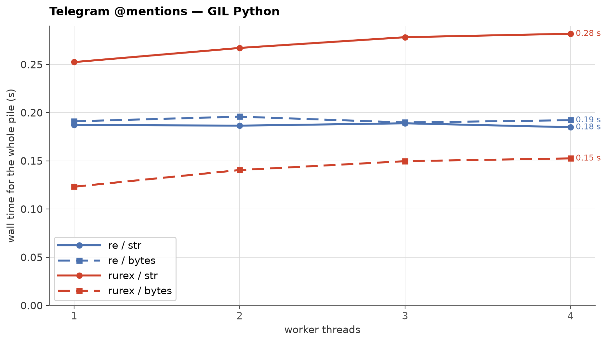
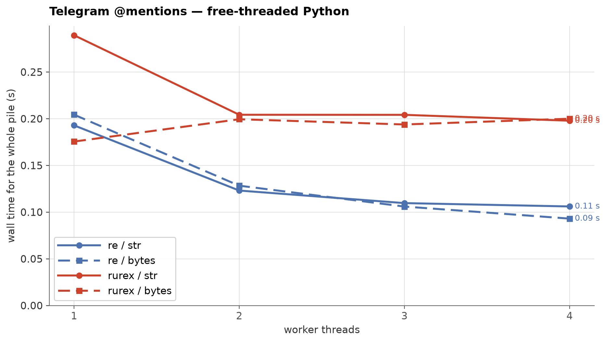

# Telegram @mention extraction: rurex vs `re`

Real-world task, measured exactly as performed: **one** pass of
`.findall(text)` over every post — one search, once, on a corpus that
has never been scanned before. Each measured point is a **fresh
interpreter process** that loads the corpus, pins its workers to
distinct physical cores, runs a fixed CPU warm-up on a separate buffer,
and then performs the single pass split across N barrier-started
workers; there is no repeat scan. This is the extraction-bound regime (short texts,
≈0.33 matches per post) — the opposite of the scan-bound workloads of
[the main benchmark page](benchmarks.md), where rurex leads ×7–13
single-threaded.

## Methodology

- **Pattern** (Telegram username rules — 5–32 chars,
  `[a-zA-Z0-9_]`, starts with a letter):
  `@[a-zA-Z][a-zA-Z0-9_]{4,31}`
- **Corpus**: 1,000,000 posts, 470 MB of text
  (mostly Arabic/Persian), 334,136 mentions in
  186,226 posts (18.6%
  of posts). Downloaded automatically from the
  [`bench-data-telegram-v1` release](https://github.com/lorien/rurex/releases/tag/bench-data-telegram-v1)
  and sha256-verified; see
  [`benchmarks/telegram/PROVENANCE.md`](../benchmarks/telegram/PROVENANCE.md).
- **CPU placement and warm-up**: the process is pinned to distinct
  physical cores; free-threaded workers are pinned one per core, while
  GIL workers share the process affinity so the active thread does not
  bounce across cores. All workers run a fixed CPU-bound warm-up on a
  separate buffer before the timed barrier. The measured corpus is
  never touched by the warm-up. Governor, load average and per-CPU
  frequency are recorded in the raw results.
- **Core lease**: the whole matrix holds `/tmp/core4.lock` (mode
  0666). A second run prints the owner metadata, waits up to 600 s, and
  then fails instead of running on the same cores.
- **Contamination guard**: each point compares CPU time with wall time.
  GIL points use process CPU / wall; free-threaded points require every
  worker's CPU / wall to stay above `RUREX_MIN_EFFICIENCY` (default
  0.90). A point above `RUREX_MAX_LOAD` or below the efficiency floor is
  rejected and retried up to `RUREX_RETRIES` (default 2); repeated
  failure aborts the run.
- **Timing window**: from the instant the post-warm-up barrier releases
  to the instant the slice is finished; a point is the max across
  workers. Load and pattern compile are outside the window,
  identically for both engines. Every run's mention count must equal
  334,136.
- **Repeats**: published rows are the median of three complete runs;
  each raw result records the individual wall times.
- **Interpreters**: GIL CPython 3.13 and free-threaded 3.14t, one
  fresh subprocess per point. CPU: 13th Gen Intel(R) Core(TM) i5-13500.

## GIL Python



| Workers | `re` str | `re` bytes | rurex str | rurex bytes | rurex/re str | rurex/re bytes |
|---:|---:|---:|---:|---:|---:|---:|
| 1 | 0.19 s | 0.19 s | 0.25 s | 0.12 s | ×1.3 | ×0.6 |
| 2 | 0.19 s | 0.20 s | 0.27 s | 0.14 s | ×1.4 | ×0.7 |
| 3 | 0.19 s | 0.19 s | 0.28 s | 0.15 s | ×1.5 | ×0.8 |
| 4 | 0.18 s | 0.19 s | 0.28 s | 0.15 s | ×1.5 | ×0.8 |

*(ratio < 1 = rurex faster)*

Each point runs both input forms. The **str** variant is the real
task on parsed text: `re` matches the UCS buffer directly, while
rurex's engine matches UTF-8 and must materialize it. The
required-first-byte prefilter (ADR-0013) skips that for the 81% of
posts with no `@` at all; the **19% that carry a mention pay one
UCS→UTF-8 encode per call**, and that encode is the entire gap on this
row (×1.3 single-threaded,
×1.5 at four workers). Measured on a 470-char
post: a cold `str` costs 630 ns, the same object with CPython's UTF-8
cache already populated costs 126 ns, and the same content as `bytes`
costs 140 ns — with the encode out of the way, `str` and `bytes` are
the same engine over the same bytes. rurex never fills that cache
itself (ADR-0012 rules out writing CPython's buffer), so a string that
nothing else has encoded is encoded on every call. That encode is
already near the hardware limit (about 1.9 GB/s against an AVX2 ceiling
of 2–3 GB/s, and this host has no AVX-512), so no fast path inside the
binding removes it; keeping the text as UTF-8 `bytes` does. The
`findall` path itself was also slimmed: it uses `find_at` and one flat
span buffer instead of a `Captures` object and a `Vec` per match.

The **bytes** variant feeds the same posts pre-encoded to UTF-8 —
the corpus is already UTF-8 on disk, so a pipeline that stays in
bytes never pays the transcode: rurex answers in
**0.12 s, beating `re`'s
0.19 s (×0.6)**
single-threaded, and remains ahead at four workers
(0.15 s vs
0.19 s). That is the
RE2-binding-recommended shape (feed UTF-8 bytes), and rurex makes it
a first-class mode.

With threads, both rurex variants get slower under the GIL
(str 0.25 → 0.28 s,
bytes 0.12 → 0.15 s
at four workers): the scans are sub-µs, so the GIL-held per-call result
building dominates and the workers convoy on the lock. `re` bytes
shows the same shape
(0.19 → 0.19 s). An earlier
build degraded to 5.38 s before the 4 KB GIL-release threshold landed;
releasing the GIL for every tiny scan was worse.

## Free-threaded Python



| Workers | `re` str | `re` bytes | rurex str | rurex bytes | rurex/re str | rurex/re bytes |
|---:|---:|---:|---:|---:|---:|---:|
| 1 | 0.19 s | 0.20 s | 0.29 s | 0.18 s | ×1.5 | ×0.9 |
| 2 | 0.12 s | 0.13 s | 0.20 s | 0.20 s | ×1.7 | ×1.6 |
| 3 | 0.11 s | 0.11 s | 0.20 s | 0.19 s | ×1.9 | ×1.8 |
| 4 | 0.11 s | 0.09 s | 0.20 s | 0.20 s | ×1.9 | ×2.1 |

*(ratio < 1 = rurex faster)*

Without the GIL both variants scale: rurex str
0.29 s → 0.20 s
and bytes
0.18 s → 0.20 s;
`re` 0.19 s → 0.11 s str,
0.20 s → 0.09 s bytes.
`re` scales further on these short texts: at four workers it wins both
forms (str ×1.9, bytes
×2.1), while rurex bytes still wins
single-threaded (×0.9). The four-worker rurex
cost is per-call result building and allocator work, not the scan.

## Reading the numbers

Read the two variants as two different questions. **str**: what a
user scanning parsed text once pays — `re` wins at every thread count,
because the prefilter removes most transcodes but not the per-call
transcode and result-building floor. **bytes**: what a UTF-8-native
pipeline pays — rurex **wins single-threaded**
(×0.6), because its engine scans UTF-8 directly with
SIMD prefilters; with four free-threaded workers `re` catches up. The
scan-bound leads on the main page (×7–13) do not transfer to
short-text per-call extraction. Machine-specific; expect different
absolute numbers elsewhere.

## Reproducing

```sh
python benchmarks/telegram.py && cp benchmarks/telegram_results.json run1.json
python benchmarks/telegram.py && cp benchmarks/telegram_results.json run2.json
python benchmarks/telegram.py && cp benchmarks/telegram_results.json run3.json
python benchmarks/merge_runs.py run1.json run2.json run3.json -o benchmarks/telegram_results.json
python benchmarks/telegram_charts.py   # regenerates the charts, this page
                                       # and the standalone HTML twin
```

---

*Raw results: [`benchmarks/telegram_results.json`](../benchmarks/telegram_results.json).
Numbers on this page were measured on 2026-10-19 with rurex 0.2.0;
see the raw results file for the exact environment.*
